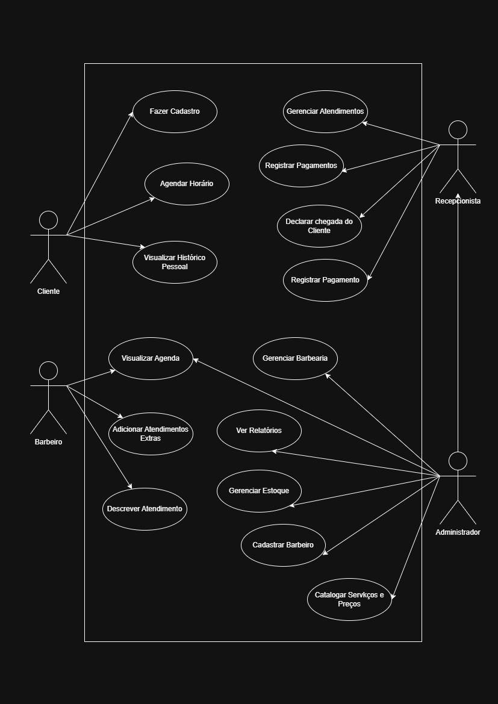
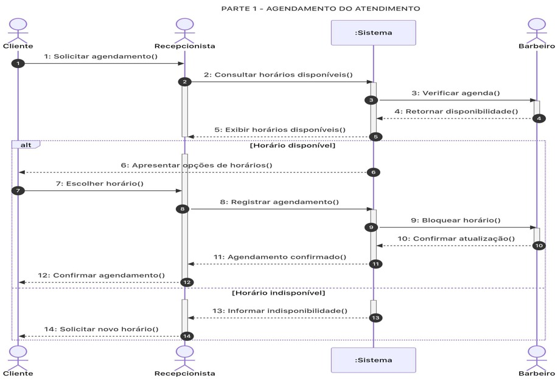
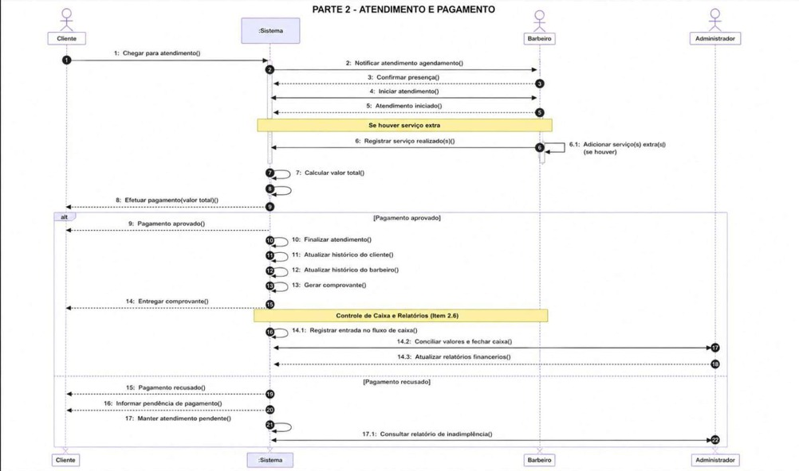
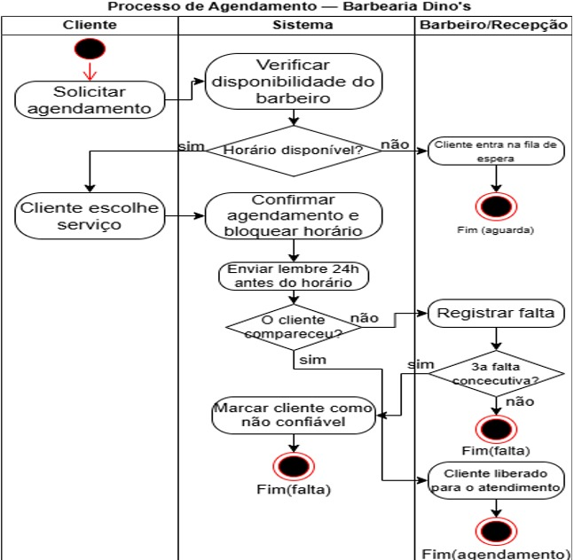
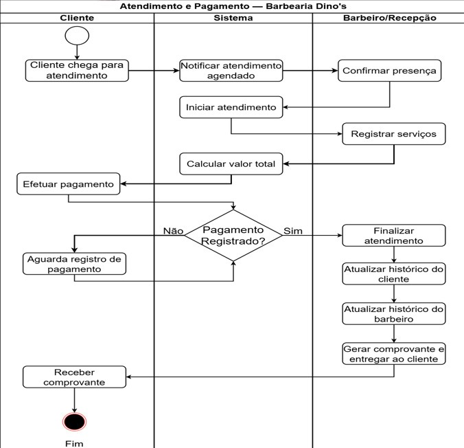

# 💈 Barbearia Dino's

> Sistema de Gestão de Barbearia — Documentação informal do software
> UFAM / ICET — Engenharia de Software — Itacoatiara/AM — 2026

## 👥 Equipe

- João Eduardo dos Santos Monteiro
- Matheus Azevedo Dino Sousa
- Willian Gonçalves Monteiro

---

## 📑 Sumário

1. [Introdução](#1-introdução)
2. [Requisitos Gerais do Software](#2-requisitos-gerais-do-software)
3. [Diagramas UML](#3-diagramas-uml)

---

## 1. Introdução

### 1.1. Descrição Geral do Software

O Sistema de Gestão Barbearia Dino's automatiza o fluxo de agendamento de horários, recepção de clientes, execução de serviços, venda de produtos, controle de faltas (bloqueio de clientes não confiáveis), faturamento, cálculo de comissões e emissão de relatórios operacionais e financeiros.

### 1.2. Descrição dos Usuários

| Usuário | O que faz no sistema |
|---------|----------------------|
| **Cliente** | Faz auto-cadastro, consulta horários disponíveis, agenda, vê seu histórico e efetua pagamentos. |
| **Barbeiro** | Vê sua agenda diária, confirma presença de clientes, adiciona serviços extras/produtos e registra a descrição dos serviços. |
| **Recepcionista** | Gerencia atendimentos presenciais, declara a chegada do cliente, registra pagamentos no caixa e aloca clientes na fila de espera. |
| **Administrador** | Gerencia a barbearia, cadastra barbeiros e serviços, controla estoque, configura preços, emite relatórios financeiros e controla restrições de faltas/inadimplência. |

---

## 2. Requisitos Gerais do Software

### 2.1. Requisitos Funcionais

| ID | Descrição | Prioridade |
|----|-----------|------------|
| RF01 | Permitir cadastro, autenticação e gestão de perfil para Clientes, Barbeiros, Recepcionistas e Administradores. | Essencial |
| RF02 | Permitir que cliente ou recepcionista agende horários com barbeiros específicos, consultando a disponibilidade em tempo real. | Essencial |
| RF03 | Permitir iniciar atendimento, incluir serviços extras, lançar produtos consumidos e finalizar o serviço. | Essencial |
| RF04 | Processar pagamentos, emitir comprovantes e registrar movimentações no fluxo de caixa. | Essencial |
| RF05 | Permitir ao administrador catalogar serviços, cadastrar produtos e atualizar quantidades de estoque. | Importante |
| RF06 | Gerar relatórios financeiros e calcular automaticamente as comissões dos barbeiros. | Essencial |

### 2.2. Requisitos Não Funcionais

| ID | Descrição | Categoria | Prioridade |
|----|-----------|-----------|------------|
| RNF01 | O tempo de resposta para verificação de horários e autenticação não deve exceder 2 segundos. | Desempenho | Importante |
| RNF02 | Senhas devem ser armazenadas criptografadas e o controle de acesso deve ser baseado em papéis (RBAC). | Segurança | Essencial |
| RNF03 | O módulo de agendamento online deve ter disponibilidade mínima de 99,5% no período comercial. | Disponibilidade | Importante |

### 2.3. Regras de Negócio

| ID | Descrição | Prioridade |
|----|-----------|------------|
| RN01 | O cliente que acumular 3 faltas consecutivas sem cancelamento prévio é marcado como "não confiável" e perde o direito ao agendamento online. | Essencial |
| RN02 | A comissão do barbeiro é calculada aplicando o percentual cadastrado sobre o valor total dos serviços executados. | Essencial |
| RN03 | Não são permitidos agendamentos duplicados para o mesmo barbeiro no mesmo intervalo de tempo. | Essencial |

---

## 3. Diagramas UML

### 3.1. Diagramas de Casos de Uso

| Ator | Casos de uso |
|------|--------------|
| Cliente | Fazer Cadastro, Agendar Horário, Visualizar Histórico Pessoal |
| Barbeiro | Visualizar Agenda, Adicionar Atendimentos Extras, Descrever Atendimento |
| Recepcionista | Gerenciar Atendimentos, Registrar Pagamentos, Declarar Chegada do Cliente |
| Administrador | Gerenciar Barbearia, Ver Relatórios, Gerenciar Estoque, Cadastrar Barbeiro, Catalogar Serviços e Preços (também herda os casos do Recepcionista e vê a agenda) |

### 3.2. Diagramas de Sequência

#### Agendamento do atendimento

O cliente solicita o agendamento à recepcionista, que consulta o sistema. O sistema verifica a agenda do barbeiro e, se o horário estiver disponível, registra o agendamento e bloqueia o horário. Caso contrário, informa a indisponibilidade e o cliente é convidado a escolher outro horário.

#### Atendimento e pagamento

O cliente chega, o sistema notifica o barbeiro, que confirma a presença e inicia o atendimento. Serviços extras são registrados, o sistema calcula o total e o pagamento é processado. Se aprovado, o atendimento é finalizado, os históricos são atualizados e o comprovante é entregue. Se recusado, o atendimento fica pendente.

### 3.3. Diagramas de Atividades

#### Processo de agendamento

Cobre a verificação de disponibilidade, a fila de espera, a confirmação com bloqueio do horário, o lembrete 24h antes e o controle de faltas (3ª falta consecutiva marca o cliente como não confiável).

#### Atendimento e pagamento

Cobre a chegada do cliente, o registro dos serviços, o cálculo do valor, o pagamento, a atualização dos históricos e a entrega do comprovante.

